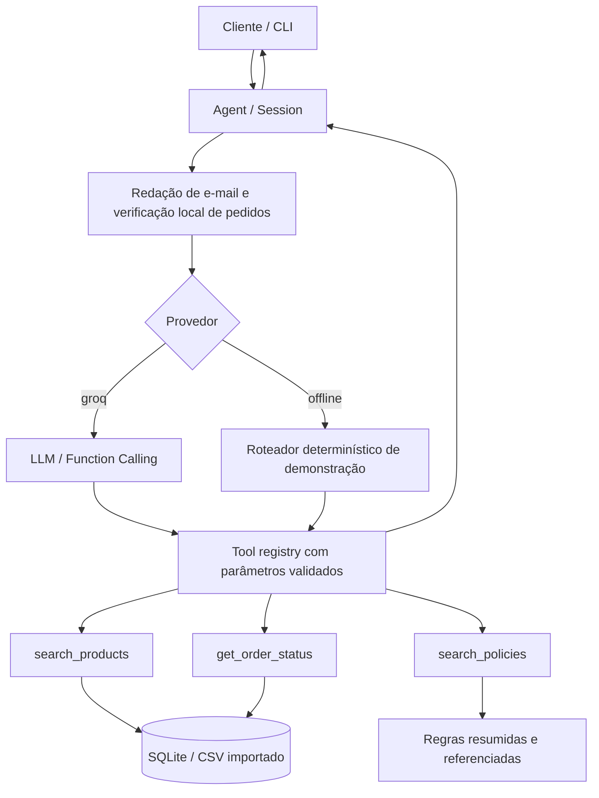

# Empório AI — agente de atendimento para instrumentos musicais

Protótipo em **Python 3.11+** para o desafio técnico de AI Engineer (Artefact, 2026).
O agente atende clientes da fictícia **Empório da Música**, consulta catálogo/pedidos e
recupera regras de atendimento por ferramentas explícitas. Há um modo offline para
revisão sem chave de API e um modo **LLM + Function Calling no Groq**.

> **Segurança e privacidade:** o repositório inclui somente **fixtures sintéticas**.
> Não publique `customers.csv`, `orders.csv` ou o manual interno do desafio.
> O catálogo original pode ser importado **localmente** para testar o cenário real.

## Pré-requisitos e execução

- Python 3.11 ou superior.
- **Sem chave de API:** modo `offline`, determinístico, **não é um LLM**.
- **Com LLM:** chave do [GroqCloud](https://console.groq.com/keys) e instalação opcional.

```bash
# clone o repositório; entre na pasta do projeto
python -m venv .venv
# Linux/macOS: source .venv/bin/activate
# Windows PowerShell: .venv\Scripts\Activate.ps1
python -m pip install -e .

# 1. Rodar perguntas com fixtures públicas e sintéticas
python -m app.cli --provider offline
python -m app.cli --provider offline --message "Quais violões disponíveis até R$ 1000?"

# 2. Rodar os testes
python -m unittest discover -s tests -v
```

### Groq (opcional; modelo real)

```bash
python -m pip install -e '.[llm]'
cp .env.example .env       # no Windows: copy .env.example .env
# Edite .env e insira sua GROQ_API_KEY; nunca a versione.
python -m app.cli --provider groq
```

O modelo configurado por padrão é `openai/gpt-oss-20b`; pode ser ajustado em
`GROQ_MODEL` caso a disponibilidade do provedor mude. Uso gratuito está sujeito
às cotas atuais da conta e do modelo; confira
[os limites](https://console.groq.com/docs/rate-limits).
Não há fallback silencioso do LLM para dados inventados: erros de API são
informados. O `groq` SDK implementa as requisições; nenhuma chamada API é
necessária no CI.

### Importação dos CSVs do desafio (somente local)

Extraia o arquivo fornecido e execute a partir da raiz do projeto:

```bash
python -m app.cli --provider offline \
  --import-dir "/caminho/Desafio Técnico AI Engineer 2026/data"
```

No PowerShell, em uma linha:

```powershell
python -m app.cli --provider offline --import-dir "C:\caminho\Desafio Técnico AI Engineer 2026\data"
```

O importador reconhece tanto `products.csv` quanto nomes originais do tipo
`desafio_tecnico_ai_eng - products.csv` e importa categorias, produtos,
promoções, clientes e pedidos. Os dados vão para **SQLite local**, ignorado pelo
Git. Um novo `--import-dir` **substitui** o snapshot anterior. Exclua o arquivo
`data/emporio.sqlite` para retornar aos dados demonstrativos na próxima execução.

**Importante:** o CSV representa um snapshot, não uma integração em tempo real.
Se os dados estiverem desatualizados, o agente apenas reportará esse registro.

## Como funciona



### Contratos das ferramentas

| Ferramenta | Acessa | Proteções |
| --- | --- | --- |
| `search_products` | Produto, estoque, promoção ativa e preço final | Consultas pré-definidas; não há SQL livre pelo LLM; limita até 10 resultados; oculta produto sem estoque/descontinuado |
| `search_policies` | Seções resumidas do manual de atendimento | Recuperação lexical por tópico e indicação de origem; não inventa políticas |
| `get_order_status` | Pedido, situação, valor e rastreio no CSV | Somente se **número do pedido + e-mail** coincidirem; verificação feita no Python; e-mail removido do contexto enviado ao LLM |

O próprio programa executa as ferramentas e devolve os resultados ao modelo:
**o LLM não acessa o banco diretamente**. Cada execução está limitada a quatro
rodadas e até cinco chamadas de ferramentas por rodada. São mantidas apenas as
últimas seis interações em memória (sem persistir mensagens ou emails no disco).

## Decisões de engenharia

1. **Orquestração manual vs. framework pesado:** com três ferramentas, controlar
   diretamente a execução facilita depurar argumentos, limites e permissões.
   Evita camadas extras de LangChain/LangGraph que não trazem vantagem clara
   para este escopo, mas permite substituí-las futuramente.
2. **SQLite sobre os CSVs:** consultas estruturadas têm resultado determinístico;
   filtro de estoque e preço nunca depende da “memória” do LLM. Para um catálogo
   de dezenas de itens não se justifica PostgreSQL ou infraestrutura remota.
3. **Retrieval lexical de políticas:** o manual tem apenas oito páginas e temas
   definidos. Regras curtas, curadas e com referência de seção funcionam sem
   embeddings nem banco vetorial. **O PDF original não é redistribuído**, por
   ser identificado como interno. Regras precisam ser atualizadas se o manual mudar.
4. **Groq com modelo intercambiável:** permite um experimento com tool calling
   em uma camada gratuita sujeita a limites. O modo offline garante uma
   demonstração reprodutível sem credenciais, sem se passar por LLM.
5. **Memória curta e autenticação mínima:** sessão em RAM; validação local do
   e-mail antes de liberar informações de um pedido. A chave de acesso não
   trafega no repositório, mas esta verificação **não é autenticação forte**;
   produção exigiria canal confiável e autenticação externa.
6. **Precisão financeira:** `Decimal` com arredondamento explícito; promoções
   só quando `is_active=1`. Não acumula desconto PIX sobre promoções.

### Avaliação e exemplos

- [Interação 1 — catálogo com orçamento](examples/01_catalogo.md)
- [Interação 2 — promoção e preço](examples/02_promocao.md)
- [Interação 3 — arrependimento/devolução](examples/03_devolucao.md)
- [Interação 4 — autenticação de pedido](examples/04_pedido.md)
- [Interação 5 — produto fora do escopo](examples/05_escopo.md)

Os exemplos são saídas executadas com **fixtures públicas sintéticas no modo
`offline`**, e não transcrições fictícias de uma execução com o modelo Groq.
Os testes de integração usam um cliente Groq simulado para validar a sequência
LLM → ferramenta → LLM. **Não foram feitos testes ao vivo com um token Groq.**

```bash
python -m unittest discover -s tests -v
```

## Limitações conhecidas e próximos passos

- Estoque, preços, promoções e rastreio dependem de arquivos importados, não de
  APIs online. `is_active` não traz datas para revalidação.
- A base lexical de políticas é mantida manualmente e alguns tópicos compartilham
  palavras, o que pode causar recuperação imperfeita.
- A versão oficial do manual contém **duas referências diferentes de telefone**
  (dados da empresa e seção WhatsApp). O protótipo prioriza o número do canal
  identificado expressamente como WhatsApp na seção 7; revisar com gerente.
- Regras do manual também distinguem troca por defeito em 30 dias e garantia
  legal em 90 dias; o agente evita equipará-las e encaminha casos ambíguos.
- Não existe abertura de chamados, alteração de pedidos, reembolso, checkout ou
  envio de WhatsApp: não afirmar essas ações ao cliente.
- Verificação por e-mail é adequada apenas à demonstração, não constitui prova
  suficiente de identidade para produção. Adicionar login seguro, rate limiting,
  autorização por cliente, auditoria e gestão da LGPD.
- Sem interface web ou observabilidade centralizada. Prioridade futura: API
  FastAPI, testes E2E com modelo real, avaliação de tool calling e telemetria
  com redação de PII antes de considerar implantação.
- Alguns termos no modo offline são heurísticos; **qualidade de linguagem natural
  depende do provedor LLM**. Testes mockados não equivalem à validação com Groq.

## Uso de assistente de IA na construção

**ChatGPT (OpenAI)** foi utilizado para: analisar o enunciado e os dados,
formular alternativas de arquitetura, gerar o esqueleto inicial do código,
desenhar as ferramentas, elaborar testes automatizados e esta documentação.
As decisões, a revisão do código, testes com LLM real, quaisquer ajustes e a
entrega final permanecem sob responsabilidade do candidato. O histórico Git é
mantido em commits incrementais por componente; o autor humano deve revisar e
melhorar o protótipo antes de submetê-lo.

## Organização

```text
app/
  agent.py       # prompts, sessão, orchestration e tool calling
  storage.py     # SQLite, importação, filtros e autenticação mínima
  policies.py    # busca lexical de políticas para cenário fictício
  settings.py    # configuração por ambiente
  cli.py         # interface CLI

data/demo/       # fixtures públicas sintetizadas, sem dados reais de clientes
examples/        # 5 interações reproduzíveis
tests/           # testes unitários e simulação do ciclo Groq
.github/workflows/ # CI básico
```

Projeto educacional para uma organização e loja fictícias; não é serviço oficial da loja.


## Validação com Groq real (fase 2)

Depois de configurar `.env` **somente no seu computador**, rode:

```bash
python -m pip install -e '.[llm]'
python -m app.cli --provider groq --message "Quanto custa o Violão Aurora GD20?"
python -m scripts.live_smoke
python -m unittest discover -s tests -v
```

`live_smoke` faz **três cenários reais** em um SQLite temporário usando apenas
fixtures sintéticas. Verifica a ferramenta invocada e alguns fatos da resposta.
Não imprime prompts, respostas, clientes ou chave de API. Cada teste gera uma
nova sessão, e a chamada pode consumir quota gratuita; não é executado no CI.
Uma falha indica algo a investigar, não comprova necessariamente defeito no
modelo. Revisão humana de tom, precisão e segurança ainda é necessária.

Perguntas sobre acessórios comerciais (ex.: palhetas, cabos, pedais) agora
exigem `search_policies` no primeiro turno do Groq; a seção `scope` é
fixada pelo backend mesmo se o modelo omitir parâmetros opcionais. Isso evita
que uma resposta sobre o escopo de vendas dependa apenas do prompt do LLM.
Perguntas gerais e buscas de instrumentos mantêm `tool_choice=auto`.

No GPT-OSS, a chamada utiliza `reasoning_effort=low` e
`max_completion_tokens=4096`. Isso evita esgotar cedo o orçamento de
raciocínio antes de uma chamada de ferramenta. O próprio Groq pode encerrar
com `finish_reason=length`: nesse caso o agente retorna erro explícito em vez
de interpretar uma resposta vazia como conteúdo. Consultas de preço e de
políticas comerciais exigem uma ferramenta na primeira rodada; saudação
continua usando `auto`. Isso é seleção de ferramenta pelo modelo **com
obrigação imposta pelo backend**, não execução automática de SQL pelo LLM.

O teste `live_smoke` agora mostra `finish`, `output` e `model` sem imprimir
respostas ou argumentos. `fact_check` é heurístico, não uma prova de
correção semântica; principalmente a palavra "não" isolada não é mais
suficiente para aprovar o cenário de escopo.

O orquestrador desativa ferramentas paralelas para compatibilidade com GPT-OSS
20B/120B e diferencia falhas de autenticação (401/403), requisição inválida
(400/404/422) e limite de quota (429), sem revelar mensagens brutas da API.
O rastreamento em memória expõe somente nomes das ferramentas, quantidade de
requisições e código HTTP, nunca seus argumentos.

Se a chave tiver sido exposta em terminal compartilhado, Git, chat ou captura
de tela, revogue-a no GroqCloud e gere outra. Configure `.env` localmente;
**nunca faça commit do arquivo `.env` nem registre a chave em GitHub Actions**.
